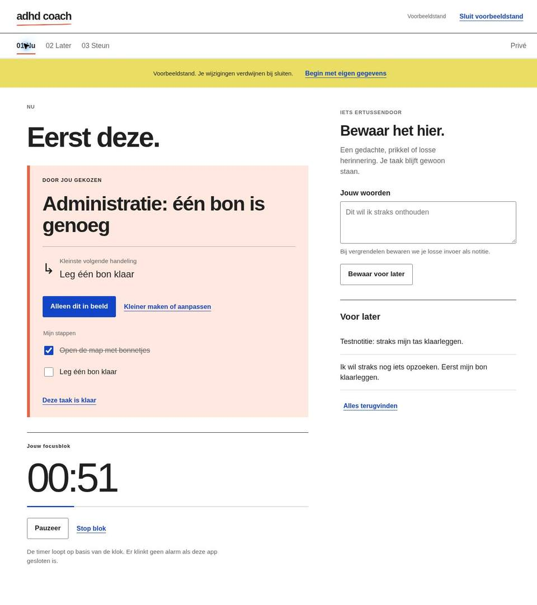

# ADHDcoach — Eerst deze.

Een eerste werkende webapp voor volwassenen die steun willen bij taakstart, afleiding en overzicht. Je kiest één taak voor nu, maakt de eerste handeling klein en parkeert wat ertussendoor komt. Je eigen woorden staan centraal.

Dit is versie 0.1: een installeerbare PWA voor telefoon en computer, met lokale versleutelde opslag. Geen account, backend, tracking, externe lettertypen of AI-dienst. De app is praktische ondersteuning; geen diagnose, behandeling of crisisvoorziening. De effecten zijn nog niet onderzocht.



## Wat werkt

- **Nu:** één actieve taak, eigen kleine stappen, afvinken, aanpassen en afronden. Een afzonderlijk focusscherm toont de volgende handeling.
- **Focusblok:** zelf 5, 10 of 15 minuten kiezen, pauzeren, hervatten en stoppen. De timer volgt de klok, ook na een onderbreking. Geen alarm wanneer de app gesloten is.
- **Snel vastleggen:** gedachten, prikkels, gevoelens, situaties en impulsen bewaren. Indelen is optioneel. Een notitie kan een taak worden; de oorspronkelijke notitie blijft bestaan.
- **Later:** zoeken, taken kiezen, afgeronde taken opnieuw klaarzetten, notities en taken aanpassen of verwijderen.
- **Steun:** eigen afspraken en zinnen opslaan. Een gekozen zin kan groot in beeld om aan iemand te laten zien; er wordt niets verstuurd.
- **Privé:** hulpmiddelen aan/uit, automatisch vergrendelen, versleutelde reservekopie downloaden/terugzetten en lokale gegevens wissen.
- **Voorbeeldstand:** uitproberen met verzonnen inhoud; wijzigingen blijven alleen in het geheugen.

## Lokaal starten

Er is geen buildstap of npm-installatie nodig. Serveer de map `app` via localhost, bijvoorbeeld met Python 3:

```sh
python3 -m http.server 8000 --directory app
```

Open `http://localhost:8000`. Een dubbele klik op `index.html` werkt niet voor deze app. Op een ander apparaat is **HTTPS** nodig voor versleuteling en installatie; een onveilig LAN-adres biedt alleen de voorbeeldstand.

Kies eerst **Eerst bekijken met voorbeelden**, of maak een eigen plek met een wachtzin van minimaal 12 tekens. Gebruik een unieke, lange wachtzin. Er is geen wachtwoordherstel. Download geregeld een versleutelde reservekopie en bewaar de wachtzin apart in een wachtwoordmanager.

## Telefoon en publicatie

Publiceer uitsluitend de inhoud van `app/` op een HTTPS static host. Relatieve paden ondersteunen ook een subpad, zoals `/Adhdcoach/`. Op Android Chrome: *App installeren* of *Toevoegen aan startscherm*. Op iPhone Safari: *Delen → Zet op beginscherm*. Offline openen kan na een geslaagde eerste download van de appbestanden; de browser bepaalt installatie en opslagruimte.

De repository zelf publiceert geen website. Deze versie heeft geen native App Store- of Play Store-pakket, geen automatische synchronisatie en geen meldingen op de achtergrond. Elk apparaat en elke browser hebben een eigen opslag. Hosting kan technische bezoekgegevens verwerken.

## Privacy in het kort

Taken, notities en afspraken worden als één AES-GCM-versleutelde kluis in IndexedDB opgeslagen. De wachtzin en leesbare inhoud gaan niet naar een server. Een reservekopie is eveneens versleuteld en gebruikt dezelfde wachtzin. Inhoud is tijdens gebruik wel leesbaar in het geheugen en op het scherm. Een gewiste browser of verloren wachtzin kan onherstelbaar verlies betekenen. Dit is nog geen onafhankelijk beveiligingsonderzoek of juridische toets.

Zie [privacy en herstel](docs/privacy.md) voor gegevensstromen, beperkingen en beheerkeuzes.

## Ontwikkelen en controleren

Node.js 22 of nieuwer (CI gebruikt Node 24):

```sh
npm run check
npm test
```

Geen externe runtime- of testafhankelijkheden. De tests toetsen modelregels, klokgedrag, cryptografische controles, opeenvolgende saves, opslagfouten en conflicten tussen sessies. [Validatie](docs/validation.md) beschrijft wat wel en nog niet in een browser is gecontroleerd.

## Verder bouwen

De [architectuur en beheerstrategie](docs/architecture.md) beschrijven de lokale kern, modules, herstel en releases. De [ADHD-roadmap](docs/roadmap.md) bevat 14 uitbreidingsmodules met doel, methodiek, relaties en relatieve prioriteit. Dat zijn voorstellen; alleen de functies hierboven zijn geïmplementeerd.

Ontwerpkeuze: grote directe taal, één hoofdhandeling en eigen afspraken. Geen productiviteitsscores, streaks, sociale vergelijking of automatische interpretatie van gevoelens. Omgevingsaanpassingen zoals schriftelijke instructies en minder afleiding passen bij de aandachtspunten in [NICE NG87](https://www.nice.org.uk/guidance/ng87/chapter/recommendations). Dat onderbouwt de ontwerprichting, niet de werkzaamheid van deze specifieke app.
