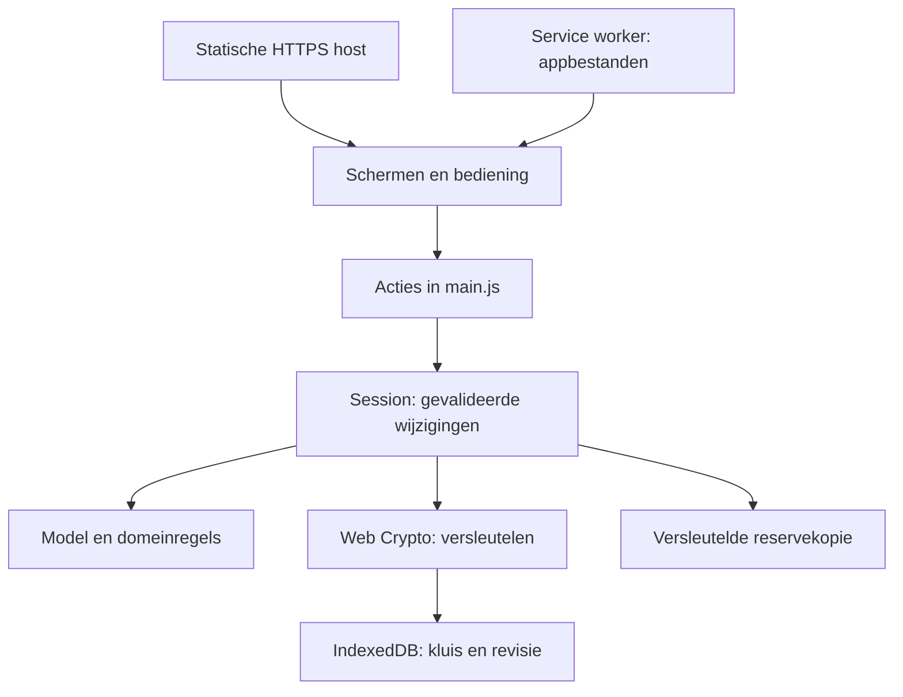
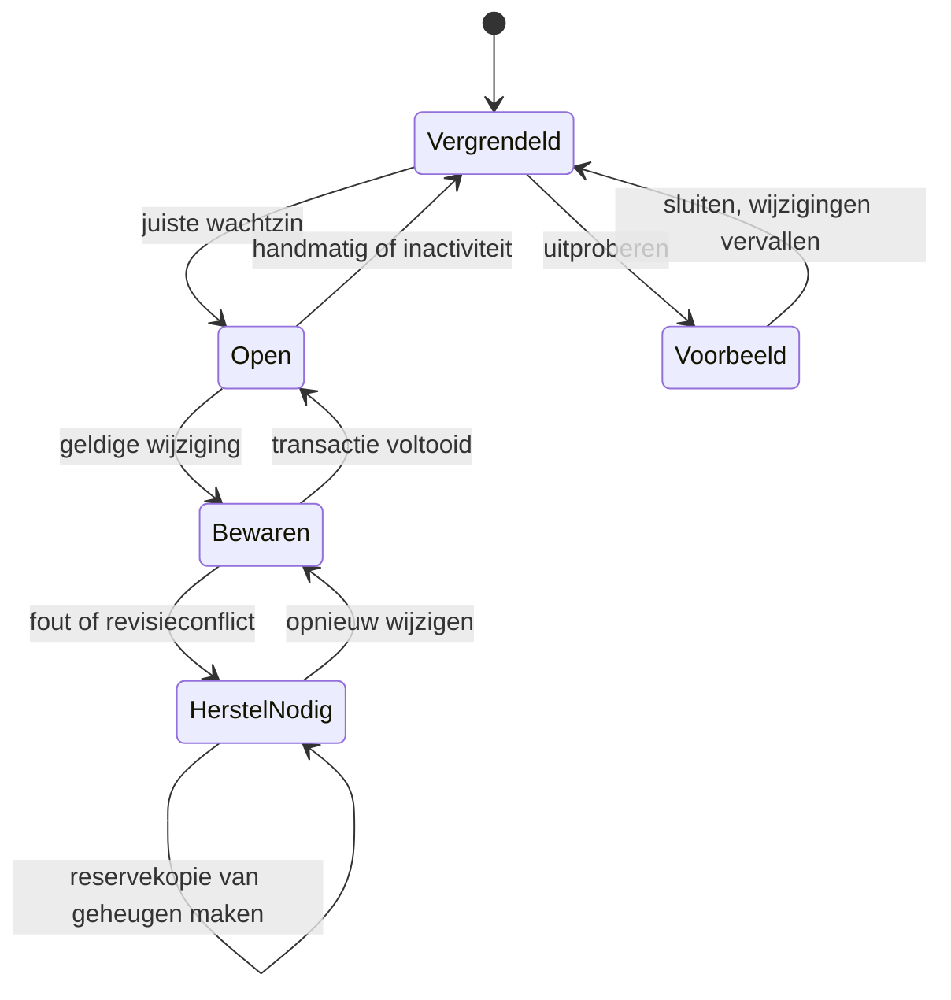

# Architectuur en beheer

## Uitgangspunt

Eerst een kleine, bruikbare lokale kern. Geen microservices of serveraccount nodig om een taak te starten. Dezelfde webapp werkt op telefoon en computer; een native omhulsel kan later dezelfde domeinregels gebruiken. De huidige kern is een modulaire monoliet in de browser, geen dynamische plugin-marktplaats.

De host levert programmabestanden. Er is geen API die gebruikersinhoud ontvangt. De service worker cachet uitsluitend een lijst appbestanden; geen kluis of exports. De reservekopie wordt op het apparaat gemaakt en via de browser gedownload.

## Verantwoordelijkheden

| Onderdeel | Bestand | Verantwoordelijkheid |
|---|---|---|
| Domeinmodel | `app/core/model.js` | Versie, inhoudslimieten, unieke IDs, actieve taak, timerregels, modulevoorkeuren |
| Cryptografie | `app/core/crypto.js` | Sleutelafleiding, envelopcontrole, versleutelen en ontsleutelen |
| Opslagadapter | `app/core/storage.js` | IndexedDB-transacties met revisiecontrole |
| Sessie | `app/core/session.js` | Openen, wijzigingswachtrij, bewaartoestand, backup, herstel, vergrendelen |
| UI-primitieven | `app/core/ui.js` | DOM-elementen, labels, knoppen, aankondigingen; geen gebruikers-HTML |
| Modules | `app/modules/*.js` | Nu, Later, Steun, Privé; tonen data via context, gebruiken acties |
| Orkestratie | `app/main.js` | Routes, formulieren, appacties, timerweergave, installatie, vergrendeling |

Een module krijgt een context met gevalideerde sessiedata en acties. Zij schrijft niet zelf naar IndexedDB. Mutaties gebruiken `session.change(mutator)`: clone → mutatie → validatie → in-memory staat → geserialiseerde encryptie en bewaarpoging. Alleen een voltooide transactie krijgt de status bewaard. Twee tabbladen kunnen elkaars wijzigingen niet stilzwijgend overschrijven.

Bij een schrijffout blijft inhoud in het geheugen. Vergrendelen wordt geweigerd zolang wijzigingen niet bewaard zijn. Een reservekopie bevat ook de actuele nog niet opgeslagen staat. Na een conflict: exporteer, herlaad en open de actuele kluis; vergelijk/herstel bewust. Automatisch samenvoegen ontbreekt.

## Een module toevoegen

1. Leg het gebruikersprobleem vast en toets met volwassenen met ADHD. Formuleer een meetbare hypothese, geen werkzaamheidsclaim.
2. Voeg een eigen view in `app/modules/` toe met dezelfde context/actiegrens. Meld de module in `MODULES` aan en koppel route/acties in `main.js`. Kleine hulpmiddelen kunnen in een bestaande route staan.
3. Breid model en validatie expliciet uit. Een ongewijzigd v1-formaat laat onbekende velden weg; nieuwe gegevens vereisen daarom een formaatversie en geteste migratie. Bewaar een reservekopie vóór migratie en werk pas na volledige validatie de kluis bij.
4. Voeg bestanden toe aan de service-worker-lijst en verhoog de cachenaam. Controleer offline openen én een update vanaf de vorige versie.
5. Documenteer welke gegevens nodig zijn, standaard uit staan en gewist/exporteerbaar zijn. Nieuwe modules krijgen geen eigen netwerktoegang zonder expliciete productbeslissing en gebruikerskeuze.
6. Toets passende domeinregels en kritieke herstelroutes. Controleer mobiele bediening, toetsenbord, schermlezer en bestaande exports voordat de release doorgaat.

Er is nu geen capability-sandbox tussen modules: alle eigen JavaScript deelt hetzelfde browserproces. Een toekomstige module van derden kan dus niet veilig als willekeurig script worden geladen. De kern bevat nog geen automatische migratie-engine of syncprotocol.

## Beheer zonder gebruikersinhoud

| Gebied | Strategie |
|---|---|
| Releases | Werk via branches en PRs; syntax/importcheck en Node-tests op iedere push. Versienummer, gegevensformaat en cacheversie bewust beheren. Gebruik een aparte testomgeving met verzonnen data. |
| Publicatie | Static HTTPS hosting; eerst staging, daarna dezelfde gecontroleerde commit. Hostheaders toevoegen: HSTS op HTTPS, `frame-ancestors 'none'` via CSP-header, `X-Content-Type-Options: nosniff`, strikte Referrer-Policy. De HTML-CSP vervangt geen hostheaders. |
| Updates | Service worker gebruikt netwerk eerst, cache bij uitval. Geen gedwongen herstart tijdens invoer. Test coherentie en offline cache bij een nieuwe release; de huidige versie biedt nog geen updatebanner of atomaire versieovergang. |
| Herstel | Approllback naar vorige commit kan alleen zolang het gegevensformaat compatibel is. Een datamigratie krijgt een aparte terugweg/export. Nooit stilzwijgend een onbekende versie overschrijven. |
| Incidenten | Vraag om versie, browser en stappen; vraag standaard geen notities, kluizen of wachtzinnen. Onderzoek met synthetische reproductie. Geen centrale fouttelemetrie in deze versie. |
| Inhoud | Praktische teksten laten beoordelen door ADHD-deskundige én ervaringsdeskundigen. Leg bron, doel en reviewdatum vast. Geen behandel-, medicatie- of diagnoselogica zonder nieuwe beoordeling. |
| Security | Laat cryptografie, XSS-risico, hosting, dependency- en releaseketen onafhankelijk onderzoeken vóór inzet met gevoelige gegevens bij een bredere doelgroep. Herhaal na ingrijpende wijzigingen. |
| Gebruikersregie | Geen beheerder kan de kluis terughalen. Helpteksten en export zijn essentieel. Publiceer vóór lancering een privacyverklaring met hostingpartij, contact en feitelijke bewaartermijnen. |

## Groei naar website, apps en optionele sync

Start met de huidige PWA. Een native wrapper vraagt afzonderlijke tests voor toetsenbord, toegankelijkheid, OS-keystore, lifecycle en lokale opslag; een webwachtzin alleen is geen native beveiligingsontwerp.

Voor synchronisatie later: bewaar alleen versleutelde objecten op een server, scheid accountidentiteit van inhoud, definieer sleuteloverdracht/herstel, verwijdering, conflictregels en metadataretentie. De huidige snapshot met één revisie is geschikt voor lokale bewaring, niet voor gelijktijdige cross-device synchronisatie. Kies en test een nieuw syncmodel vóór implementatie. Cloud-AI, begeleiding en delen zijn afzonderlijke opt-ins en nooit een impliciet gevolg van synchronisatie.
